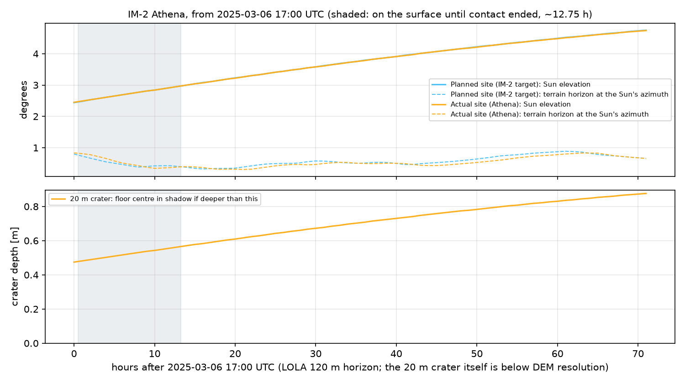

# SELENE illumination pipeline

One-off generator of per-site **sunlight** and **Earth-visibility** time series for the
SeleneFrontend app. For each candidate landing site it computes a terrain horizon from
NASA LOLA topography, then evaluates the Sun and Earth against that horizon every hour
from 2027-01-01 to 2028-12-31.

Output goes to `SeleneFrontend/wwwroot/data/illumination/`.

## Setup

Python 3.11+. (`pyshp` is only needed by `import_wueller_sites.py`.)

```bash
cd pipeline
python -m venv .venv
source .venv/bin/activate          # Windows: .venv\Scripts\activate
pip install -r requirements.txt
python download_kernels.py         # SPICE kernels → pipeline/kernels/ (~19 MB)
```

`download_kernels.py` fetches the four kernels used in Skyfield's *Planetary reference
frames* guide from NAIF `generic_kernels`: `de421.bsp`, `moon_080317.tf`, `pck00008.tpc`,
and `moon_pa_de421_1900-2050.bpc`. NAIF keeps `de421.bsp` and `pck00008.tpc` in
`a_old_versions/` folders, and the script uses those official URLs. If a download fails,
the script names the file that failed and exits with an error. There are no fallback
mirrors.

## Terrain model (download manually)

Use a **LOLA south-polar DEM in polar stereographic projection, 60–120 m/px**, from the
PDS Geosciences Node:

<https://pds-geosciences.wustl.edu/lro/lro-l-lola-3-rdr-v1/lrolol_1xxx/data/lola_gdr/polar/float_img/>

Recommended file: **`ldem_75s_120m_float.img`** together with its label
**`ldem_75s_120m_float.lbl`** (233 MB, 75°S–90°S, 120 m/px). Download both into the
same folder and **pass the `.lbl` file** to `--dem`. GDAL opens PDS3 products through
their label.

Why 75°S: horizon rays are 150 km long, which is about 5° of latitude. A site at 84°S
therefore needs terrain coverage down to about 79°S. An 80°S product would cut those
rays short. The finer `ldem_75s_60m_float` also works, but it is 4× larger and slower.

The DEM loader reads CRS and geotransform from the file and hard-codes neither. Some
LOLA conventions are handled automatically:

* Heights in the `float` products are in **kilometres**. Units are auto-detected (values
  smaller than ±30 can only be km). Use `--dem-units m|km` to force the units.
* The label `OFFSET = 1737.4` is the reference-sphere radius, not a height offset. Only
  the scale factor is applied.

A GeoTIFF in metres (for example a PGDA high-resolution product) works too.

## Run

Quick test, one site (~1 s once the DEM is loaded):

```bash
python build.py --dem /path/to/ldem_75s_120m_float.lbl --site malapert_massif
```

All sites in `SeleneFrontend/wwwroot/data/sites.json`:

```bash
python build.py --dem /path/to/ldem_75s_120m_float.lbl
```

Other options: `--start/--end` (UTC, default 2027-01-01T00:00Z … 2028-12-31T23:00Z),
`--sites`, `--out`, `--observer-height` (m, default 2), `--max-distance-km` (default 150),
`--kernels`, `--dem-units`. When you run a single site, only that site's entry in
`index.json` is updated.

Tests:

```bash
python -m pytest -q                                          # synthetic DEM + ephemeris
SELENE_DEM=/path/to/ldem_75s_120m_float.lbl python -m pytest -q   # + real DEM check
```

## Landing-site selection

The nine regions are NASA's October 2024 list of Artemis III candidate regions. They are
~15 km wide. The specific landing points come from peer-reviewed work:

```bash
python import_wueller_sites.py                 # Zenodo → data/wueller2026_sites.csv (130 sites, 16 regions)
python select_sites.py --dem /path/to/ldem_75s_120m_float.lbl   # best site per region + rebuild
```

1. **Candidates.** The 130 candidate landing sites (Table A1) come from Wueller et al.
   (2026), *JGR Planets* 131(3), e2025JE009434, using the authors' georeferenced release
   on Zenodo ([doi:10.5281/zenodo.17084058](https://doi.org/10.5281/zenodo.17084058),
   CC-BY-4.0). The shapefile uses a south-polar stereographic projection with true scale
   at **−70°**. It is reprojected with the `.prj` shipped in the archive and
   cross-checked against the attribute lat/lon. All nine of our regions are covered,
   with 78 candidates in total, so the grid fallback (500 m spacing, 15 × 15 km around
   the old approximate centre, marked `approximate: true`) was **not** needed.
2. **Slope filter.** Slope is computed from the DEM (3 × 3 px window, Horn's method).
   Candidates above `--max-slope` (default **10°**) are rejected. **10° is our
   assumption, not a NASA requirement.** Note that 120 m pixels smooth out local
   slopes. No published candidate was rejected: all have ≤ 4° at 120 m/px, which is
   consistent with the authors' own ≤ 8° HLS-area filter.
3. **Score.** Scoring uses 2027-01-01 … 2028-12-31, hourly, with the same horizon and
   ephemeris code as `build.py` (`build.compute_series`). The metrics are:
   * **lit %**: hours with `sunFraction ≥ 50`
   * **Earth %**: hours with Earth > horizon + 0.5°
   * **longest darkness**: longest run with `sunFraction < 50`
   * **longest continuous light**
4. **Ranking.** Highest lit % first. Among candidates within 1 percentage point of the
   best, the highest Earth % wins, then the shortest longest-darkness.

`sites.json` gets the best point per region with these fields: `approximate: false`,
`source` (DOI + "best of N candidate sites by SELENE illumination score"),
`candidateId`, `regionCenter` (the previous approximate coordinate, kept stable across
re-runs), `candidatesEvaluated`, and `alternatives` (next three). Every evaluated point
is written to `illumination/candidates/{regionId}.json`, which the map overlay can use.

`index.json → pctSunlit` keeps its original definition (any sunlight, `sunFraction > 0`).
It is therefore higher than the selection's **lit %** (`≥ 50`).

## Method

| Step | File | What it does |
|---|---|---|
| Horizon mask | `horizon.py` | Casts 360 rays at 1° steps out to 150 km, sampled at the DEM resolution with bilinear heights. Ray points are generated on the lunar sphere (R = 1 737 400 m) by great-circle bearing, then projected into the DEM, so azimuths are **true** (from lunar north) and not grid azimuths. Each sample's elevation angle is `atan2(dh − d²/2R, d)` (curvature drop included), and each ray keeps the maximum. The observer stands at terrain + 2 m. |
| Sun / Earth positions | `ephemeris.py` | Skyfield with DE421 and the `MOON_ME_DE421` frame (`moon_080317.tf` + `moon_pa_de421_1900-2050.bpc`). Gives topocentric apparent altitude/azimuth, hourly. No refraction, because the Moon has no atmosphere. |
| Visibility | `illumination.py` | `sunFraction = clamp((sunElev − h + r) / 2r, 0, 1)` with r = 0.267°, where h is the horizon interpolated linearly at the Sun's azimuth. `earthVisible = earthElev > h + 0.5°`. |

**`sunFraction` is a linear approximation.** It ramps linearly while the disk centre moves
from one solar radius below the local horizon to one radius above it. The exact visible
area of a disk cut by a straight line is an S-curve with the same endpoints and the same
midpoint (0.5). The largest difference is 5.8 percentage points, at about 0.6 radius from
the horizon. Statistics based on "any sunlight" (`sunFraction > 0`) are unaffected.

Other assumptions:

* The Moon is treated as a sphere of 1737.4 km, the same reference that LOLA heights use.
* The horizon line between neighbouring 1° azimuths is linear.
* Terrain beyond 150 km, or outside the DEM, is ignored.
* `index.json → horizonCoveragePct` reports how much of each site's ray length had valid
  DEM data.

### Validation

* **Sun geometry.** Peak solar elevation at −85.8° comes out at 5.78°. The analytic
  value is (90° − 85.8°) + 1.54° = 5.74°. `tests/` checks this bound at several
  latitudes.
* **Azimuth convention.** A synthetic DEM with a mountain placed at true bearing 135°
  produces its horizon peak at 135°.
* **Known sunniest spot.** A search at DEM resolution along the Shackleton–de Gerlache
  connecting ridge finds a maximum of **89.7 % sunlit time over 2027–28 at
  (−89.438°, −137.28°)**. The literature reports ~89–92 % for the best ridge points
  (Mazarico et al. 2011, Icarus 211; Gläser et al. 2014), computed over different time
  spans and DEM resolutions. **This is not a like-for-like check.** NASA's own LOLA
  map at that exact point reads only 71.0 % (120 m) and 65.2 % (60 m) over 18.6 years
  (see [Validation vs NASA LOLA illumination maps](#validation-vs-nasa-lola-illumination-maps)).
  A narrow ridge is where our 120 m DEM and 2 m observer are most optimistic. The point
  comparison at the 9 landing sites below is the stronger validation.

## Validation vs JPL Horizons

`validate_horizons.py` checks the Sun and Earth positions against
[NASA/JPL Horizons](https://ssd.jpl.nasa.gov/horizons/), which is an independent
implementation running a newer ephemeris (DE441). The check covers all 9 sites at 24
epochs (2027-02-01, 2027-08-15, 2028-03-20 and 2028-10-05, 00–05 UTC hourly). Each
query asks for the apparent azimuth and elevation (`QUANTITIES='4'`) as seen from
`CENTER='coord@301'`, `COORD_TYPE='GEODETIC'`, `SITE_COORD='lon,lat,0'`. The raw
responses are stored in `data/horizons/`, so the check and `tests/test_horizons.py` run
offline.

```bash
python validate_horizons.py            # compare using the stored snapshots
python validate_horizons.py --refresh  # re-query the API (sends only public site coordinates)
```

**Conventions.** These were read from the Horizons response headers and confirmed by the
numbers below.

* The site coordinates are east longitude and latitude in the lunar **Mean-Earth (ME)**
  frame (`Center pole/equ : MEAN_ME (high precision)`). That is the same frame as our
  `MOON_ME_DE421`.
* The reference surface is a sphere with R = 1737.4 km, as in our model.
* Azimuth is measured clockwise from north. Elevation is airless (no refraction) and
  apparent.
* Times are UTC.

No conversion is needed. If the site is placed in the Principal-Axis frame instead, the
residuals grow by a factor of about 2000.

Results (pipeline or shipped JSON minus Horizons, absolute values, 378 samples per row: 7 dates
2026-11-20 … 2035-12-15, 6 hours each; re-run 2026-11-15 for the 2026–2035 data):

| Comparison | Elevation range | max \|Δel\| | mean \|Δel\| | max \|Δaz\| | mean \|Δaz\| |
|---|---:|---:|---:|---:|---:|
| Sun: pipeline (DE421, `MOON_ME_DE421`) | −7.6° … 7.9° | 0.000014° (0.052″) | 0.000006° (0.021″) | 0.000008° (0.028″) | 0.000003° (0.009″) |
| Earth: pipeline (DE421, `MOON_ME_DE421`) | −8.5° … 11.4° | 0.000014° (0.052″) | 0.000009° (0.033″) | 0.000009° (0.032″) | 0.000004° (0.013″) |
| Sun: shipped `illumination/*/*.json` (0.01° steps) | −7.6° … 7.9° | 0.0050° | 0.0024° | 0.0050° | 0.0026° |
| Earth: shipped `illumination/*/*.json` (0.01° steps) | −8.4° … 11.4° | 0.0050° | 0.0026° | 0.0050° | 0.0024° |
| *Sun: site in `MOON_PA_DE421` (wrong frame)* | | *0.0235°* | *0.0143°* | *0.0211°* | *0.0191°* |
| *Earth: site in `MOON_PA_DE421` (wrong frame)* | | *0.0236°* | *0.0219°* | *0.0214°* | *0.0186°* |

The pipeline agrees with Horizons to about 0.05″ over the whole range, up to the end of 2035. The shipped files agree to within their
0.01° rounding. The test uses a tolerance of **0.001°** for the pipeline. That is about
100× the observed residual, which leaves headroom if Horizons moves to a newer ephemeris.
It is still 20× tighter than the ME↔PA offset, so a frame or convention error fails the
test. The tolerance for the shipped JSON is **0.006°**: half a rounding step plus the
pipeline tolerance. The reasoning is written out in the test's docstring. For scale, the
horizon mask uses 1° azimuth steps and the solar radius is 0.267°.

## Validation vs NASA LOLA illumination maps

`compare_nasa_illumination.py` compares our sunlight and Earth visibility at the 9
landing sites with NASA's published LOLA polar illumination maps:

* **Source:** Mazarico, E., et al. (2011), *Illumination conditions of the lunar polar
  regions using LOLA topography*, Icarus 211, 1066–1081, doi:10.1016/j.icarus.2010.10.030.
  Maps are release 2016 on the PDS Geosciences Node
  ([files](https://pds-geosciences.wustl.edu/lro/lro-l-lola-3-rdr-v1/lrolol_1xxx/extras/illumination/img/),
  [PGDA product page](https://pgda.gsfc.nasa.gov/products/69)):
  * `AVGVISIB_75S_120M_201608`: 120 m/px, the same resolution as our DEM
  * `AVGVISIB_85S_060M_201608`: 60 m/px, south of −85° only
  * the `_EARTH` variants of both
* **What a pixel means:** per the PDS label, the share of hourly timesteps when the pixel was
  sunlit "by any fraction of the solar disc". The Earth maps use any part of Earth's disc.
  PGDA says the Sun maps cover a full lunar nutation cycle (~18.6 years). Neither page gives
  the exact dates or the observer height, which is most likely the surface.
* **Our side:**
  * The definition is matched: `sunFraction > 0`, the same as `index.json → pctSunlit`.
  * We use each site's stored horizon (120 m DEM, observer 2 m) with fresh JPL DE421
    positions over 18.6 years from 2009-07-13, the label's START_TIME.
  * We also report 2027–28, the period the app uses. That recomputation reproduces
    `index.json` to within 0.2 pp, which is tested.
  * For Earth, "any part of the disc" uses the angular radius from the actual Earth
    distance. The app's own comms criterion (centre > horizon + 0.5°) is shown alongside.
* **How the maps are read:** the labels name `*.IMG` in upper case, but the server stores
  lower case, so GDAL cannot open the remote pair. `--refresh` instead:
  1. downloads only the `.lbl`;
  2. lets GDAL read the map geometry from it;
  3. fetches the 3 × 3 pixels around each point with HTTP Range requests (~30 KB each).

  The samples are kept in `data/nasa_illumination/samples.csv`, so the script and
  `tests/test_nasa_comparison.py` run offline.
* **Orientation check:** the floors of Shackleton (−89.67°, 129.8°E) and Faustini
  (−87.3°, 77°E) read exactly 0 % in all four maps, as permanently shadowed regions should.
  Their mirror images across longitude 0 do not.

```bash
python compare_nasa_illumination.py            # offline: table, data/nasa_illumination/comparison.json, docs/nasa_vs_ours.png
python compare_nasa_illumination.py --refresh  # re-sample the NASA maps (public URLs only)
```


**Sunlight** (% of hours with any part of the solar disc visible, at our landing points, 18.6-year average):

| Site | NASA 120 m | NASA 3×3 px range | Ours at the surface (0 m) | Δ (0 m) | Ours, panels 2 m (app) | Δ (2 m) | Ours 2027–28 (2 m) | NASA 60 m |
|---|---:|---:|---:|---:|---:|---:|---:|---:|
| Peak near Cabeus B | 52.5 % | 39.0–55.0 % | 52.5 % | **+0.0 pp** | 54.3 % | +1.8 pp | 53.8 % | — |
| Haworth | 66.6 % | 47.7–67.7 % | 66.1 % | **-0.5 pp** | 70.6 % | +4.0 pp | 70.4 % | 62.1 % |
| Malapert Massif | 69.8 % | 42.7–74.3 % | 74.5 % | **+4.7 pp** | 81.2 % | +11.4 pp | 81.9 % | 64.0 % |
| Mons Mouton Plateau | 42.7 % | 41.4–42.8 % | 42.6 % | **-0.1 pp** | 43.0 % | +0.3 pp | 42.7 % | — |
| Mons Mouton | 74.3 % | 37.3–78.4 % | 71.0 % | **-3.3 pp** | 79.1 % | +4.8 pp | 79.5 % | 56.8 % |
| Nobile Rim 1 | 83.5 % | 52.5–83.5 % | 75.0 % | **-8.5 pp** | 83.8 % | +0.3 pp | 84.3 % | 76.8 % |
| Nobile Rim 2 | 52.4 % | 29.3–52.4 % | 52.4 % | **+0.0 pp** | 53.4 % | +1.0 pp | 53.8 % | — |
| de Gerlache Rim 2 | 78.5 % | 48.9–78.5 % | 76.4 % | **-2.1 pp** | 79.4 % | +0.9 pp | 79.6 % | 72.5 % |
| Slater Plain | 58.3 % | 50.1–59.1 % | 57.5 % | **-0.8 pp** | 60.1 % | +1.8 pp | 60.8 % | 52.9 % |

**Earth visibility** (% of hours):

| Site | Earth NASA 120 m (any part of disc) | Ours at the surface (0 m) | Δ (0 m) | Ours, 2 m | Δ (2 m) | Ours, app criterion (centre > horizon + 0.5°, 2 m) |
|---|---:|---:|---:|---:|---:|---:|
| Peak near Cabeus B | 72.6 % | 75.2 % | +2.6 pp | 83.5 % | +10.9 pp | 71.9 % |
| Haworth | 60.2 % | 60.2 % | +0.0 pp | 61.1 % | +0.9 pp | 54.0 % |
| Malapert Massif | 65.2 % | 69.5 % | +4.3 pp | 75.4 % | +10.2 pp | 66.7 % |
| Mons Mouton Plateau | 84.8 % | 83.9 % | -0.9 pp | 84.9 % | +0.1 pp | 73.5 % |
| Mons Mouton | 64.4 % | 72.9 % | +8.5 pp | 79.6 % | +15.2 pp | 69.9 % |
| Nobile Rim 1 | 64.2 % | 68.6 % | +4.4 pp | 70.2 % | +6.0 pp | 62.3 % |
| Nobile Rim 2 | 66.3 % | 65.7 % | -0.6 pp | 66.5 % | +0.2 pp | 58.9 % |
| de Gerlache Rim 2 | 61.3 % | 61.1 % | -0.2 pp | 61.8 % | +0.5 pp | 54.6 % |
| Slater Plain | 40.2 % | 36.1 % | -4.1 pp | 41.0 % | +0.8 pp | 33.5 % |

**Like-for-like at NASA's own pixel centres** (`compare_nasa_pixels.py`). The tables above compare our exact landing
points with the NASA pixel that contains them; a pixel centre can be 85 m (120 m map) away, and on summits one pixel
changes sunlit time by 20–30 pp. This script evaluates our model at the centre of every pixel of the 3 × 3 windows,
in both maps, over the same 18.6 years, on the LOLA DEM of the **same resolution** (120 m for the 120 m map,
`ldem_75s_60m_float` for the 60 m map), with the observer at the surface (0 m) and at 2 m (the app):

| Site | NASA map (our DEM) | NASA centre | Ours 0 m | Ours 2 m | 3×3 mean bias 0 m | 3×3 mean abs 0 m | 3×3 mean bias 2 m |
|---|---|---:|---:|---:|---:|---:|---:|
| Peak near Cabeus B | 120 m | 52.5 % | 52.7 % | 54.5 % | +0.5 pp | 1.0 pp | +2.6 pp |
| Haworth | 120 m | 66.6 % | 66.9 % | 70.8 % | +0.6 pp | 1.7 pp | +7.3 pp |
| Haworth | 60 m | 62.1 % | 65.2 % | 70.8 % | +3.0 pp | 3.0 pp | +13.4 pp |
| Malapert Massif | 120 m | 69.8 % | 75.0 % | 81.9 % | +1.1 pp | 4.1 pp | +10.3 pp |
| Malapert Massif | 60 m | 64.0 % | 57.4 % | 78.2 % | +2.5 pp | 4.4 pp | +17.3 pp |
| Mons Mouton Plateau | 120 m | 42.7 % | 42.6 % | 43.0 % | -0.0 pp | 0.1 pp | +0.4 pp |
| Mons Mouton | 120 m | 74.3 % | 78.2 % | 81.5 % | +3.6 pp | 3.6 pp | +11.7 pp |
| Mons Mouton | 60 m | 56.8 % | 70.6 % | 80.2 % | +10.3 pp | 10.5 pp | +26.3 pp |
| Nobile Rim 1 | 120 m | 83.5 % | 83.1 % | 86.2 % | +1.0 pp | 2.3 pp | +8.8 pp |
| Nobile Rim 1 | 60 m | 76.8 % | 75.6 % | 85.4 % | +1.5 pp | 3.1 pp | +16.8 pp |
| Nobile Rim 2 | 120 m | 52.4 % | 52.0 % | 53.1 % | -0.8 pp | 1.3 pp | +3.2 pp |
| de Gerlache Rim 2 | 120 m | 78.5 % | 78.4 % | 80.1 % | -1.7 pp | 2.0 pp | +4.5 pp |
| de Gerlache Rim 2 | 60 m | 72.5 % | 73.3 % | 80.3 % | +4.3 pp | 4.9 pp | +17.4 pp |
| Slater Plain | 120 m | 58.3 % | 58.8 % | 60.2 % | +0.7 pp | 0.9 pp | +3.9 pp |
| Slater Plain | 60 m | 52.9 % | 53.6 % | 59.4 % | +1.0 pp | 1.3 pp | +5.0 pp |

All pixels: 120 m map, observer 0 m — bias +0.6 pp, mean |Δ| 1.9 pp, 93 % of 81 pixels within 5 pp; observer 2 m — bias +5.9 pp. 60 m map, observer 0 m — bias +3.8 pp, mean |Δ| 4.5 pp, 76 % of 54 pixels within 5 pp; observer 2 m — bias +16.1 pp.

```bash
python compare_nasa_pixels.py --dem /path/ldem_75s_120m_float.lbl --dem60 /path/ldem_75s_60m_float.lbl   # ~15 min
python compare_nasa_pixels.py ... --refresh    # re-read the NASA 3x3 windows (data/nasa_illumination/pixels.csv)
```

**What it shows:**

* **The method reproduces NASA's maps.** Under NASA's conditions (surface, same terrain resolution, NASA's pixel
  centres) our sunlit time differs from the 120 m map by 1.9 pp on average (bias
  +0.6 pp, every site ≤ 4.1 pp) and from the 60 m map by 4.5 pp
  (Mons Mouton is the only site above 5 pp). There is no systematic excess.
* **The app's numbers are higher by design.** The app's series put the panels and antenna 2 m above the ground.
  On summits and rims that looks over nearby terrain: +5.9 pp on average at NASA's pixels,
  +0…+9 pp at our points. The app shows how much the verdict depends on it (robustness row "PANELS 1–3 m",
  `build_heights.py`, table below).
* **The earlier "120 m DEM optimism" (+7…+22 pp vs the 60 m map) was mostly this**, plus comparing a 120 m model
  with a 60 m map at a different point. On the 60 m DEM our 2 m values at the landing points change by −1.9…+0.9 pp
  (Malapert 81.2 → 79.3 %, Mons Mouton 79.1 → 78.1 %, Nobile Rim 1 83.8 → 84.7 %). The finer DEM matters at the
  surface, where small bumps decide.
* **Point registration:** Nobile Rim 1 is −8.5 pp at our point (0 m) but 83.1 vs 83.5 % at NASA's pixel centre.
* **Earth** agrees within 1 pp at 5 sites; at the surface the summit outliers shrink (Cabeus B +10.9 → +2.6,
  Malapert +10.2 → +4.3, Mons Mouton +15.2 → +8.5 pp).
* **Period effect is small:** at all 9 sites 2027–28 is within 1 pp of the 18.6-year average.

### Model sensitivity (measured 2026-11-15)

| Change | Effect on sunlit time at the 9 sites (18.6 years or whole data range) |
|---|---|
| Azimuth step 0.25° instead of 1° | ≤ 0.1 pp |
| Horizon rays 300 km instead of 150 km | ≤ 0.3 pp |
| Exact solar-disc segment instead of the linear approximation | 0.0 pp in mean sunFraction (the errors cancel); ≤ 5.8 pp in single hours |
| LOLA 60 m DEM instead of 120 m (observer 2 m) | −1.9 … +0.9 pp |
| Observer 1 m instead of 2 m | −0.1 … −4.6 pp (Nobile Rim 1, Mons Mouton, Malapert most) |
| Observer 3 m instead of 2 m | +0.1 … +2.3 pp |
| Observer at the surface (0 m) | −0.3 … −9.0 pp |

`build_heights.py` writes the horizons for 0, 1, 2, 3, 5, 8, 10, 20, 25 and 40 m (every lander's `panelHeightM` in `landers.json`; the app rebuilds the series for the selected lander's height) to `illumination/{siteId}/heights.json` (the 2 m
mask must equal the yearly files', which the script checks); per-height sunlit time:

```bash
python build_heights.py --dem /path/to/ldem_75s_120m_float.lbl     # ~10 s, prints the table
```

## Case study: IM-2 Athena (March 2025)

`case_study_im2.py` replays a real CLPS landing with the same method as the 9 regions (LOLA 120 m horizon,
150 km rays, observer 2 m, JPL DE421): Intuitive Machines' Nova-C lander **Athena** (IM-2) at the planned
and at the actual landing point, hourly from 2025-03-06 17:00 UTC for 15 days.

| Fact | Value | Source |
|---|---|---|
| Planned site | −84.78°, 29.13°E (given to 0.01°, about ±150 m) | [LROC 1401](https://lroc.im-ldi.com/images/1401), 26 Feb 2025 |
| Actual site | −84.7906°, 29.1957°E, "on its side within a 20-meter diameter crater" | [LROC 1408](https://lroc.im-ldi.com/images/1408), 10 Mar 2025 |
| Distance | 369 m between the two coordinates (NASA: "more than … 400 meters" in the text, "about 820 feet" in a caption) | computed; [NASA release 25-025](https://www.nasa.gov/news-release/nasa-receives-some-data-before-intuitive-machines-ends-lunar-mission/) |
| Touchdown / end of contact | ~17:30 UTC 6 Mar / 06:15 UTC 7 Mar 2025 → **12.75 h** on the surface | NASA release 25-025 |

```bash
python case_study_im2.py --dem dem/ldem_75s_120m_float.lbl   # → SeleneFrontend/wwwroot/data/casestudy/im2/, docs/im2_case_study.png
python diviner_temperatures.py [--refresh]                    # LRO Diviner ground temperatures → SeleneFrontend/wwwroot/data/thermal/diviner.json
```



**Light and Earth** (from the series):

| | Planned, on the surface (12.75 h) | Actual, on the surface | Planned, 14 days | Actual, 14 days |
|---|---:|---:|---:|---:|
| Sun: any part of the disc visible | 100 % | 100 % | 95.8 % | 94.9 % |
| Earth visible | 100 % | 100 % | 85.4 % | 85.4 % |
| Sun elevation, max | 2.96° | 2.96° | 5.37° | 5.36° |
| Lowest Sun clearance above the LOLA horizon | 1.64° | 1.61° | −1.23° | −1.11° |
| 20 m crater floor stays dark if deeper than | 0.56 m | 0.56 m | 0.99 m | 0.99 m |

NASA's LOLA 120 m illumination map (~18.6-year average, Mazarico et al. 2011) gives 46.5 % sunlit time at the
planned site and 46.8 % at the actual one, and 93 % Earth visibility at both.

**Power and battery** (frontend, `Services/CaseStudyIm2.cs`; Nova-C figures from `landers.json`: 494 W array,
1554 Wh battery, loads partly ASSUMPTION). Which way Athena faced or fell is not published, so every result is a
range over orientations: 24 headings upright, 24 fall directions × 12 headings on its side (panel normals rotated
by 90°, same panels and K).

| First 12.75 h | Mean solar power | Battery lasts (14 d design life) |
|---|---:|---:|
| Planned site, upright | 12–466 W (median 143) | 10 h – 13.9 d |
| Actual site, upright | 12–466 W (median 143) | 10 h – 13.8 d |
| Actual site, on its side | 0–524 W (median 194) | 9 h – 13.8 d |
| No sunlight at all (dark crater floor) | 0 W | **9–14 h** (day / survival load) |

**What it shows:**

* The ~370 m miss changed nothing in our model. Both points had the Sun (2.4–3.0° high) and the Earth in view
  the whole time, give the same power range, and NASA's long-term map rates them the same.
* Power depended on attitude, not on the site. Upright it ranges from 12 to 466 W with the heading, and on its
  side from 0 to 524 W with how it lay. The reported "only about 100 watts" (secondary source: Wikipedia, citing
  CNN and Intuitive Machines) fits inside both ranges, so it does not tell how Athena lay.
* What matches the end after 12.75 h is having no usable sunlight: the 1554 Wh battery alone lasts 9–14 h on our
  loads. A 20 m crater needs to be only ~0.6 m deep to keep its floor centre in shadow at this Sun elevation.
  Athena was reported to rest in a "shadowed crater" (secondary source).

**Limits:**

* The tool shows light and power at a site; it cannot predict a tip-over.
* The 20 m crater is below the 120 m DEM resolution. We state only the depth above which its floor is dark; the
  real depth is not published.
* The following are not modelled: cold, dust, the antenna and the altimeter (reported failures), and the lander's
  real loads.
* The planned surface duration is not published, so the 14-day design life from the specs is used.

## Validation vs NASA statement

NASA's 2022 release states that *"All 13 regions contain sites that provide continuous
access to sunlight throughout a 6.5-day period – the planned duration of the Artemis III
surface mission"*
([nasa.gov](https://www.nasa.gov/news-release/nasa-identifies-candidate-regions-for-landing-next-americans-on-moon/)).
The statement covers the 2022 list of 13 regions. Only **5 of our 9** are on that list.
Mons Mouton, Mons Mouton Plateau, Peak near Cabeus B and Slater Plain were added in the
October 2024 update. For those four the same 6.5-day test is **our planning criterion,
not a NASA claim**.

Test (`tests/test_site_selection.py`): for the selected site of each region, 2027–28 must
contain at least one uninterrupted window of **≥ 156 h** with `sunFraction ≥ 50`.

| Region | Selected site (lat, lon) | Lit % (≥ 50) | Earth % | Longest continuous light | ≥ 6.5 d | Basis |
|---|---|---:|---:|---:|:---:|---|
| Peak near Cabeus B | `PCB04` (-83.3691, -67.6646) | 53.0 | 70.2 | 412 h (17.2 d) | ✅ yes | our criterion (region added 2024) |
| Haworth | `HW_K2023` (-86.9895, -24.2545) | 65.2 | 55.3 | 696 h (29.0 d) | ✅ yes | NASA 2022 statement |
| Malapert Massif | `MMA_K2023` (-85.9919, 2.0564) | 78.2 | 67.4 | 4,061 h (169.2 d) | ✅ yes | NASA 2022 statement |
| Mons Mouton Plateau | `MMP10` (-84.1383, 25.6422) | 41.5 | 73.9 | 358 h (14.9 d) | ✅ yes | our criterion (region added 2024) |
| Mons Mouton | `MMO02` (-85.4810, 29.5494) | 75.2 | 70.8 | 1,403 h (58.5 d) | ✅ yes | our criterion (region added 2024) |
| Nobile Rim 1 | `NR103` (-85.5456, 37.5572) | 78.9 | 62.4 | 3,883 h (161.8 d) | ✅ yes | NASA 2022 statement |
| Nobile Rim 2 | `NR205` (-83.6185, 59.0568) | 52.2 | 60.6 | 427 h (17.8 d) | ✅ yes | NASA 2022 statement |
| de Gerlache Rim 2 | `dGR2_K2023` (-88.4500, -67.8591) | 76.5 | 54.9 | 662 h (27.6 d) | ✅ yes | NASA 2022 statement |
| Slater Plain | `SP09` (-87.1838, 133.3445) | 59.0 | 33.7 | 468 h (19.5 d) | ✅ yes | our criterion (region added 2024) |

**All nine regions pass.** The weakest is Mons Mouton Plateau, at 14.9 days of continuous
light: 2.3× the requirement.

Caveats that could lower these numbers:

* The DEM is 120 m/px. Small-scale relief such as boulders, small craters and local
  ridges is smoothed out, which tends to overestimate sunlight.
* The observer stands 2 m above the terrain (panel height). Lower would mean more
  shadowing.
* The time span is 2027–28, not a full 18.6-year nutation cycle.
* The solar disk uses the linear approximation described above.

### Consistency with Wueller et al. (2026)

The source shapefile also carries the authors' own illumination counts per year
(`SunDays27`, `SunDays28`). They are copied into `data/wueller2026_sites.csv`. Their
values never exceed 32. That suggests the counts cover a fixed "midsummer" window,
which matches the dataset description ("illumination conditions … for the midsummers"),
so check the exact definition in the paper. Our number is the longest continuous light
across the **whole** year, so we expect ours ≥ theirs.

For the 9 selected sites × 2 years, this holds in **15 of 18** cases. The three
exceptions differ by 0.5–2.3 days (HW_K2023 2027, SP09 2027, NR205 2028), which is
plausible given their much finer DEMs. This is a consistency check, not a
like-for-like validation.

## Science layer: permanently shadowed regions (water ice)

Artemis goes to the south pole for water ice, which survives only in craters that never see the Sun. A solar lander
needs the opposite. `build_psr.py` turns NASA's LOLA map of permanently shadowed regions into a sun-vs-ice trade-off:

```bash
python build_psr.py --psr /path/to/lpsr_75s_120m_201608.lbl     # ~15 s → SeleneFrontend/wwwroot/data/science/psr.json
```

* **Input:** `LPSR_75S_120M_201608` (Mazarico et al. 2011, PDS Geosciences Node, `extras/illumination/img/`, 116 MB),
  a binary map on exactly the grid of our 120 m DEM. 27,702 km² of PSR in 75–90°S, 2310 regions ≥ 1 km², 334 ≥ 10 km².
* **Output** (`data/science/psr.json`, 21 KB gzip): for the 9 sites and the 78 Wueller et al. (2026) candidates of
  their regions, the straight-line distance to the nearest PSR pixel (any size, ≥ 1 km², ≥ 10 km²), the PSR area within
  2 / 5 / 10 km, the nearest PSR ≥ 1 km² and, per region, the Pareto front of "more sunlight" (candidates' `sunPct`,
  ≥ half the disc, panels 2 m, 2026-11 … 2035) vs "closer to a PSR ≥ 1 km²". Plus simplified PSR outlines (≥ 0.05 km²,
  simplified to half a pixel) within 15 km of each site for the 3D view.
* **Tests** (`tests/test_psr.py`): the floors of Shackleton and Faustini are PSR, the Malapert site is not, distances are
  ordered, and along each front less sunlight always buys a closer PSR.

| Site | Nearest PSR | PSR ≥ 1 km² | PSR ≥ 10 km² | PSR within 5 km | Front (sunlit · km to PSR ≥ 1 km²) |
|---|---:|---:|---:|---:|---|
| Peak near Cabeus B | 7.4 km | 10.4 km | 17.0 km | 0.0 km² | PCB04* 53 % · 10.4 |
| Haworth | 1.2 km | 8.3 km | 10.5 km | 0.8 km² | HW_K2023* 65 % · 8.3 → HW01 56 % · 2.2 → HW10 18 % · 0.8 |
| Malapert Massif | 0.6 km | 10.5 km | 28.9 km | 0.3 km² | MMA_K2023* 78 % · 10.5 → MMA04 16 % · 3.2 |
| Mons Mouton Plateau | 0.4 km | 5.0 km | 20.5 km | 0.9 km² | MMP11 41 % · 3.2 → MMP05 25 % · 0.6 (site MMP10 41 % · 5.0, chosen for Earth contact) |
| Mons Mouton | 1.5 km | 12.0 km | 22.2 km | 0.9 km² | MMO02* 75 % · 12.0 → MMO01 71 % · 6.3 → MMO07 28 % · 1.0 |
| Nobile Rim 1 | 3.4 km | 11.8 km | 16.6 km | 1.1 km² | NR103* 78 % · 11.8 → NR102 65 % · 6.8 |
| Nobile Rim 2 | 1.5 km | 7.4 km | 15.7 km | 0.4 km² | NR205* 52 % · 7.4 → NR202 49 % · 2.6 → **NR201 45 % · 0.3** (19.5 km² of PSR within 5 km) |
| de Gerlache Rim 2 | 1.2 km | 6.9 km | 9.2 km | 0.9 km² | dGR2_K2023* 76 % · 6.9 → dGR204 52 % · 4.4 |
| Slater Plain | 1.0 km | 5.2 km | 18.3 km | 1.4 km² | SP09* 58 % · 5.2 → SP05 33 % · 3.0 |

\* = our site (the sunniest candidate). Limits: distances are straight lines, not walking paths; permanent shadow marks
where ice *can* be trapped (cold traps), not where it has been detected; the PSR map is the 2016 release at 120 m.

**Full verdicts near the ice (stage 3).** Per region, `build_psr.py` also picks the **ice-first** candidate: the point
of the front closest to a PSR ≥ 1 km² that is not the site, lit at least 40 % of the time and closer to ice than the
site (the same rule as `PsrRegion.IceFirst` in the app). It writes them in `sites.json` format to
`data/science/ice_sites.json`, and they get exactly the data the 9 regions have:

```bash
python build_psr.py --psr /path/lpsr_75s_120m_201608.lbl                       # → psr.json (iceSite per region) + ice_sites.json
python build.py --dem /path/ldem_75s_120m_float.lbl --sites ../SeleneFrontend/wwwroot/data/science/ice_sites.json --no-index
python build_heights.py --dem /path/ldem_75s_120m_float.lbl --sites ../SeleneFrontend/wwwroot/data/science/ice_sites.json
python build_ellipse.py --dem /path/ldem_75s_120m_float.lbl --sites ../SeleneFrontend/wwwroot/data/science/ice_sites.json
python diviner_temperatures.py --refresh                                       # adds their Diviner ground temperatures
```

`--no-index` keeps them out of `index.json` (the heatmap stays at 9 regions); their yearly files live in
`illumination/{region}_ice/`. The app re-runs the shown mission there (same lander, date and length) and finds the
ice site's own best date in the window (`IceComparison`, ANALYST tab "Sun vs ice" and one sentence in the site step).

| Region | Ice-first | Sunlit (any Sun, 2026-11 … 2035) | Earth | Longest dark |
|---|---|---:|---:|---:|
| Haworth | HW02 | 50.6 % | 55.4 % | 416 h |
| Mons Mouton Plateau | MMP11 | 43.3 % | 55.5 % | 489 h |
| Mons Mouton | MMO09 | 55.9 % | 45.5 % | 395 h |
| Nobile Rim 1 | NR102 | 67.0 % | 61.5 % | 317 h |
| Nobile Rim 2 | NR201 | 46.0 % | 71.5 % | 404 h |
| de Gerlache Rim 2 | dGR204 | 57.0 % | 51.5 % | 551 h |
| Slater Plain | SP01 | 44.3 % | 37.7 % | 408 h |

Cabeus B and Malapert have no ice-first site (every closer candidate is lit less than 40 % of the time).

## Thermal: night heaters and LRO Diviner ground temperatures

```bash
python diviner_temperatures.py            # offline: snapshot → SeleneFrontend/wwwroot/data/thermal/diviner.json
python diviner_temperatures.py --refresh  # re-read the Diviner tables over HTTP (~4 min, ~1,200 requests)
```

**Data:** LRO Diviner Polar Cumulative Product (PCP), diurnal, south pole, binned by subsolar longitude
(Williams et al. 2019, *JGR Planets* 124, 2505–2521, doi:10.1029/2019JE006028; PDS4 bundle
`urn:nasa:pds:lro_diviner_derived1`, doi:10.17189/wj0s-w188). 96 bins of 3.75° of subsolar longitude × 2 seasons
(summer = subsolar latitude < 0), average bolometric surface temperature of 2009–2019 nadir observations in 240 m bins.
Each table is ~190 MB of fixed 59-byte ASCII records sorted by (x, y), so the script reads only the 3×3 bins around each
point with multi-range HTTP requests. The bin grid is fitted once (centres at integer multiples of 0.000138158 in
normalised stereographic x, y = 240.04 m); a point's bin centre is 36–116 m from it.

**Gaps:** bins without an observation take the mean of the 8 neighbouring 240 m bins, else linear interpolation along
the subsolar longitude. Per site 15–50 of 96 bins per season are interpolated (`*Bins` in the JSON).

**Hourly ground temperature (frontend, `DivinerPoint`):** the subsolar point seen from the site is the point
90° − elevation away along the Sun's azimuth (both stored in the yearly files), so each hour gets the curve value at
that subsolar longitude and season. No new hourly data.

**Independent check (two NASA data sets):** Diviner temperature in the hours our LOLA horizon model calls lit
(sunFraction ≥ 50) vs dark, 2027–2028, panels 2 m:

| Site | lit, mean K | dark, mean K | dark, 90th pct K |
|---|---|---|---|
| Cabeus B | 216.0 | 79.4 | 91.0 |
| Haworth | 153.7 | 75.5 | 117.1 |
| Malapert Massif | 149.0 | 75.7 | 123.8 |
| Mons Mouton Plateau | 187.9 | 69.5 | 84.6 |
| Mons Mouton | 155.7 | 72.1 | 101.3 |
| Nobile Rim 1 | 159.3 | 93.8 | 154.3 |
| Nobile Rim 2 | 166.8 | 63.9 | 73.9 |
| de Gerlache Rim 2 | 176.6 | 85.4 | 115.9 |
| Slater Plain | 182.6 | 71.2 | 99.9 |

Where our terrain model says "shadow", Diviner sees cold ground at every site (64–94 K vs 149–216 K).

**Heater model (frontend, `Services/ThermalModel.cs`, figures in `landers.json → thermal`, all ASSUMPTION):** one warm
box (battery + avionics). Lit: held at +20 °C. Dark: loss Q = G·(T⁴ − F·T_ground⁴) with G = heatLossW / T_op⁴, heatLossW
= the day load (radiators sized to dump it, no louvers), F = 0.5; the survival electronics heat the box; it cools
(C·dT/dt = P_int − Q, C = 10% of the dry mass × 0.897 kJ/(kg·K)) to −20 °C, then heaters supply max(0, Q(−20 °C) − P_int).
Sanity check: Blue Ghost (600 Wh, 120 W) carries ~4.6 h of darkness with heaters; Mission 1 ran about 5 h after sunset.
Nova-C's 104 W survival load keeps it at about −6 °C on its own (no heaters). Limits: one node, no louvers or variable
heat pipes, the box re-warms instantly when lit, the 240 m bin average is not the lander's own footprint, and the cold sky
dominates the loss at night (ground at 60–100 K returns 1–6% of it).

## Landing ellipse

Landers miss their target. Blue Ghost Mission 1 touched down within its 100 m target, Nova-C IM-2 more than
400 m off (NASA), and NASA requires Artemis landers to land within 100 m of a target. Near the pole one
120 m pixel can decide between a lit ridge and a shadow, so the app re-checks the verdict over the whole
landing area instead of a single point.

```bash
python build_ellipse.py --dem /path/to/ldem_75s_120m_float.lbl              # all sites, ~30 s per site
python build_ellipse.py --dem /path/to/ldem_75s_120m_float.lbl --validate   # + the checks below
```

`build_ellipse.py` writes `illumination/{siteId}/ellipse.json`: a 60 m grid (half a DEM pixel, bilinear
heights) of 197 points within 480 m of each site, the largest landing radius in `landers.json`. Each point
stores its own horizon mask and three frame numbers; no hourly series. The frontend rebuilds sunFraction and
earthVisible at every point from the **site's** Sun and Earth series and re-runs the shown mission there
(`LandingEllipse.cs`, same heading, date and duration).

Why that is enough (`ellipse.py`): the Sun and the Earth are so far away that their direction is the same
480 m away. What changes is the terrain horizon and the local frame. Near the pole, local north turns by
up to ~0.6° over 480 m (meridian convergence) and the vertical tilts by d/R = 0.016°. The point's mask stays
in its own 1° grid and the site's azimuth is shifted into it (`azShiftDeg`), and the elevation gets the tilt
term (`tiltDeg`, `tiltAzDeg`). An earlier version resampled each mask into the site frame; that second
interpolation smoothed sharp horizon features and cost up to 15 pp in single hours.

`--validate` recomputes 5 points per site (0, 480 m E, 480 m S, 424 m NW, 170 m NE) directly, with their own
ephemeris and horizon, over 2027–28 (17,544 h), and compares with the reconstruction from the shipped site
series (`docs/ellipse_validation.json`). It also compares our sunlit range over the 3×3 points 120 m apart
(2027–28, any Sun) with the NASA LOLA map's 3×3-pixel range (18.6 years):

| Site | Max Δ sunFraction | Hours > 1 pp | Earth hours differing | Ours ±120 m | NASA 3×3 px |
|---|---|---|---|---|---|
| Peak near Cabeus B | 2 pp | 0.1% | 5 | 49.1–56.0% | 39.0–55.0% |
| Haworth | 2 pp | 0.61% | 7 | 53.8–70.5% | 47.7–67.7% |
| Malapert Massif | 2 pp | 0.34% | 6 | 53.5–83.7% | 42.7–74.3% |
| Mons Mouton Plateau | 2 pp | 0.15% | 3 | 41.5–43.1% | 41.4–42.8% |
| Mons Mouton | 2 pp | 0.54% | 4 | 56.9–81.6% | 37.3–78.4% |
| Nobile Rim 1 | 2 pp | 0.39% | 4 | 54.9–84.2% | 52.5–83.5% |
| Nobile Rim 2 | 2 pp | 0.15% | 5 | 45.4–53.8% | 29.3–52.4% |
| de Gerlache Rim 2 | 2 pp | 0.39% | 4 | 48.9–79.7% | 48.9–78.5% |
| Slater Plain | 2 pp | 0.2% | 4 | 50.7–65.0% | 50.1–59.1% |

* The reconstruction error (≤ 2 pp, a few Earth hours out of 17,544) is the same as at the site itself:
  it comes from the centi-degree rounding of the shipped files, not from the method.
* Against NASA, the upper ends agree within 0–9 pp, and Nobile Rim 1, de Gerlache Rim 2, Mons Mouton
  Plateau and Haworth match closely. Our lower ends are often higher than NASA's (Mons Mouton 57% vs
  37%). The NASA pixels are not the same points (map grid vs our east/north grid), the period differs
  (18.6 years vs 2027–28), and the 120 m DEM smooths small ridges. Read the ellipse as "at least this
  sensitive", not as an upper bound on the risk.
* Slopes come from the 120 m DEM (Horn, 3×3 pixels) and are smoother than the real surface.

## Custom sites: data for the in-browser analysis (80–90°S)

The app can analyse **any point** of the south polar cap, not only the 9 regions. The browser cannot run
Skyfield or read the 230 MB DEM, so `export_browser_data.py` exports two compact datasets
(contract in CLAUDE.md):

```bash
python export_browser_data.py --dem /path/ldem_75s_120m_float.lbl     # ~1 s
```

| Data | Content | Size (raw → gzip / brotli) |
|---|---|---|
| `data/ephem/{year}.bin` 2026-11 … 2035 | per hour: sub-solar and sub-Earth latitude/longitude and distance, apparent, seen from the Moon's centre in `MOON_ME_DE421` (Float32 × 6) | 0.21 MB → 0.19 MB per year, 1.9 MB in total |
| `data/dem/south80_240m.bin` | LOLA heights 80–90°S, 2 536 × 2 536 px at 240 m (mean of 2 × 2 120 m pixels), Int16 metres, row-delta encoded | 12.9 MB → 6.6 MB / 5.2 MB |

The browser (`PolarDem`, `CustomSiteMath`, `CustomSiteService`) does what `horizon.py` and `illumination.py` do:

* **Sun and Earth:** the body vector minus the observer's position on the sphere (R = 1 737.4 km), projected
  on the local east/north/up axes. This topocentric step adds the Earth's parallax, up to 0.26°, which is more
  than half of the 0.5° Earth margin, so it is needed. The Sun's parallax is below 0.001°.
* **Horizon:** 360 rays to 150 km with a step of one DEM pixel (240 m), bilinear heights, curvature drop
  `elev = atan2(dh − d²/2R, d)`, observer 2 m above the terrain. Points along a ray are built as unit
  vectors and projected with x = 2R·Y/(1−Z), y = 2R·X/(1−Z), so there is no trigonometry per sample.
  Rays leaving the DEM keep their maximum inside it (as in the pipeline). The exported DEM stops at 80°S,
  so near that latitude some rays are cut.
* **Visibility:** the same `sunFraction` (linear disk, r = 0.267°) and Earth margin 0.5°.

**Validation** (`SeleneFrontend.Tests/CustomSiteTests.cs`):

* Sun and Earth direction vs JPL Horizons, 3 sites × 42 epochs 2026–2035: ≤ 0.005° (the 0.01° storage step).
* Projection vs pyproj check points: < 1 cm.
* Synthetic terrain: flat ground gives a horizon of −0.03° (observer 2 m + curvature). A 600 m wall 6 km
  away gives its known angle.
* Browser method (240 m) vs pipeline (120 m) for the 9 regions, 2027–2028:

| Region | Sunlit % pipeline (120 m) | browser (240 m) | Δ pp | Earth % pipeline | browser | Δ pp | Longest dark h pipeline | browser | horizon ms |
|---|---:|---:|---:|---:|---:|---:|---:|---:|---:|
| Peak near Cabeus B | 53.8 | 53.2 | −0.6 | 70.2 | 71.4 | +1.2 | 359 | 362 | 66 |
| Haworth | 70.3 | 70.6 | +0.3 | 55.3 | 55.3 | 0.0 | 397 | 382 | 14 |
| Malapert Massif | 81.9 | 81.8 | −0.1 | 67.4 | 68.6 | +1.2 | 325 | 323 | 13 |
| Mons Mouton Plateau | 42.8 | 43.3 | +0.5 | 73.9 | 75.3 | +1.4 | 464 | 461 | 14 |
| Mons Mouton | 79.5 | 80.0 | +0.5 | 70.8 | 71.4 | +0.6 | 226 | 216 | 14 |
| Nobile Rim 1 | 84.2 | 86.3 | +2.1 | 62.4 | 62.3 | −0.1 | 283 | 210 | 14 |
| Nobile Rim 2 | 53.8 | 53.4 | −0.4 | 60.6 | 60.7 | 0.0 | 356 | 399 | 13 |
| de Gerlache Rim 2 | 79.6 | 79.8 | +0.2 | 54.9 | 54.9 | 0.0 | 246 | 246 | 14 |
| Slater Plain | 60.8 | 60.2 | −0.6 | 33.7 | 35.5 | +1.9 | 333 | 357 | 14 |

Target was ≤ 5 percentage points of sunlit time for every region: the worst is **2.1 pp (Nobile Rim 1)**,
the median 0.5 pp. Earth contact is within 1.9 pp. The longest night can differ by tens of hours
(Nobile Rim 1: 210 h vs 283 h), because the 240 m terrain smooths small ridges that briefly block a Sun
skimming the horizon. That is why the app marks custom results as *Quick estimate · 240 m terrain*.
Horizon times in the last column are native .NET; in the browser (Release build) a mask takes ~20–30 ms of
compute and a 3-year series ~10 ms.

## Output format

`illumination/{siteId}/{year}.json` (one file per site and calendar year, 2026-11 … 2035; same fields in every file):

```jsonc
{
  "siteId": "malapert_massif", "lat": -85.8, "lon": -3.5, "observerHeightM": 2,
  "start": "2027-01-01T00:00:00Z", "stepHours": 1, "count": 8760,   // one calendar year; 2026 starts 2026-11-01
  "sunFraction": [0..100],            // % of solar disk visible (int)
  "sunElevCentiDeg": [int],           // Sun elevation × 100
  "sunAzCentiDeg": [int],             // Sun azimuth × 100, clockwise from north
  "earthVisible": [0|1],
  "earthElevCentiDeg": [int],
  "earthAzCentiDeg": [int],           // Earth azimuth × 100 (added 2026-11-14)
  "horizonDeg": [360 floats],         // horizon elevation at azimuth 0..359°
  "generatedWith": { "dem": "...", "kernels": [...], "method": "linear-disk-approx" }
}
```

`illumination/index.json` lists every site with `pctSunlit` (share of hours with
`sunFraction > 0`), `pctComms`, `longestDarkHours`, and `horizonCoveragePct`.

`illumination/{siteId}/ellipse.json` (`build_ellipse.py`, optional for the app):

```jsonc
{
  "siteId": "malapert_massif", "lat": -85.99, "lon": 2.06, "observerHeightM": 2,
  "spacingM": 60, "radiusM": 480,
  "points": [{
    "e": -120, "n": 60,                      // offset east / north of the site (m)
    "lat": ..., "lon": ..., "groundM": ..., "slopeDeg": 3.1,
    "azShiftDeg": -0.06, "tiltDeg": 0.0045, "tiltAzDeg": 296.6,   // site frame → point frame
    "pctSunlit": 61.2, "pctComms": 74.0,     // whole data range, like index.json
    "horizonCentiDeg": [360 ints]            // the point's own horizon × 100, azimuth in its own frame
  }],
  "generatedWith": { "dem": "...", "method": "own-frame horizon + azShift/tilt (pipeline/ellipse.py)" }
}
```

`illumination/{siteId}/heights.json` (`build_heights.py`, optional for the app; the robustness row "PANELS 1–3 m"):

```jsonc
{
  "siteId": "nobile_rim_1", "lat": -85.55, "lon": 37.0, "seriesObserverHeightM": 2,
  "heights": [{ "heightM": 0, "pctSunlit": 74.2, "pctComms": 61.0, "horizonCentiDeg": [360 ints] }, …],   // 0, 1, 2, 3, 5, 10 m
  "generatedWith": { "dem": "...", "method": "horizon.horizon_profile per observer height" }
}
```

## Data sources

* Candidate landing sites: Wueller, L., Berger, L. M., Christopher, H., et al. (2026),
  *JGR Planets* 131(3), e2025JE009434, doi:10.1029/2025JE009434. Data:
  doi:10.5281/zenodo.17084058 (CC-BY-4.0).
* LOLA gridded topography: Smith et al., LRO LOLA RDR/GDR, NASA PDS Geosciences Node.
* Ephemeris and lunar orientation kernels: NASA/JPL NAIF generic kernels.
* Skyfield: Rhodes, B., *Skyfield: High precision research-grade positions for planets
  and Earth satellites*.
